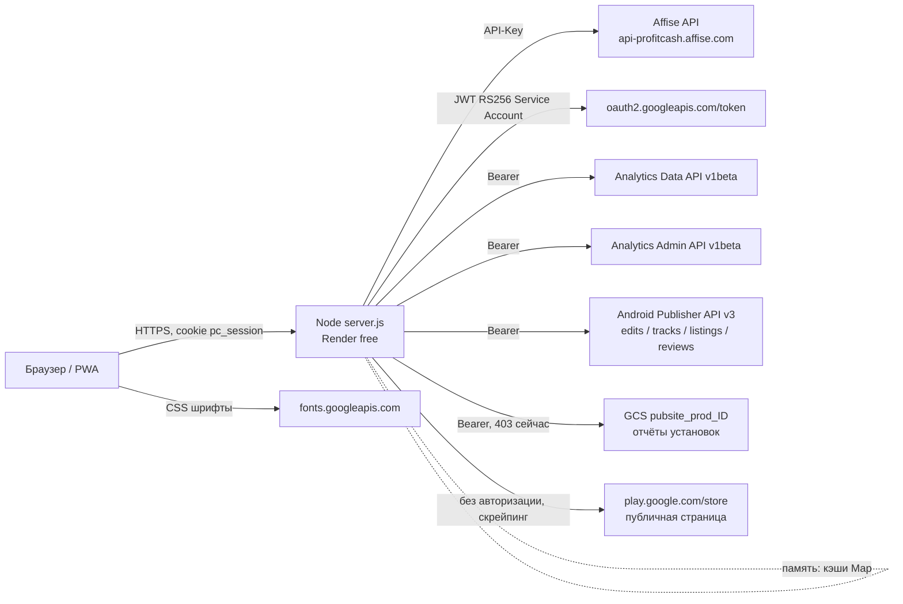

# Технический аудит: Google Cloud, Firebase и внешние API

Проект: `profitcash-stats` (дашборд партнёрской статистики ProfitCash / LeadCash + аналитика Firebase-приложений + статусы Google Play).
Дата аудита: 2026-10-22. Состояние кода: ветка `main`, коммит `c56d4d5` (в рабочем каталоге после него изменений нет).

Метод: чтение исходников (`server.js`, `ga.js`, `play.js`, `demo.js`, `public/index.html`, `public/sw.js`, `render.yaml`, `package.json`, `.env.example`, `.gitignore`), поиск по истории git, несколько безопасных чтений API (без записи). Секреты не приводятся.

Обозначения: **[К]** — подтверждено кодом или прямой проверкой; **[П]** — предположение; **[?]** — нужно проверить в Google Cloud Console / Render, из кода не видно.

---

## 1. Общая архитектура

### 1.1 Назначение
Личный дашборд за паролем:
1. **Партнёрка** — статистика из Affise API (клики, хосты, конверсии, заработок, баланс, офферы, гео).
2. **Wonga / Mpowa** — аналитика Android-приложений из Google Analytics 4 (данные Firebase Analytics): активные пользователи, версии, страны, события, realtime.
3. **Google Play** — статусы релизов, версии, даты, отзывы по 10 приложениям двух аккаунтов разработчика.

### 1.2 Стек [К]
| Слой | Что |
|---|---|
| Backend | Node.js ≥18, один файл-сервер на встроенном `http`, **без зависимостей** (`package.json`: нет `dependencies`) |
| Frontend | Один `public/index.html` (~970 строк, vanilla JS, inline SVG), PWA (`manifest.webmanifest`, `sw.js` — только passthrough, ничего не кэширует) |
| База данных | **Нет.** Всё в памяти процесса (`Map`) |
| Хостинг | Render, веб-сервис, `plan: free` (`render.yaml:5`) |
| Внешние данные | Affise API, Google Analytics Data/Admin API, Google Play Android Publisher API, публичная страница Google Play, Google Fonts (клиент) |

### 1.3 Где что хранится [К]
- Данных пользователя и БД нет. Кэши — `Map` в памяти: `server.js:55` (Affise), `ga.js:121`, `play.js:28,64,74,112,157`.
- Сессия — подписанный cookie `pc_session` (HMAC-SHA256, 30 дней), состояния на сервере нет (`server.js:8-10,160`).
- Лимит попыток входа — `Map` в памяти (`server.js:12`).
- Ключи и настройки — переменные окружения (на Render — Environment; локально `.env`, он в `.gitignore`).
- Ручные настройки Google Play (`PLAY_PACKAGES`, `PLAY_FLAGS`, `PLAY_RELEASED`, `PLAY_HIDE`) — тоже env, значения по умолчанию зашиты в `play.js`.

### 1.4 Авторизация, фон, обновление [К]
- Один общий пароль `DASH_PASSWORD` (форма `/login`, `server.js:152-161`), 5 попыток в минуту на IP, cookie `HttpOnly; SameSite=Lax`, `Secure` только при `x-forwarded-proto: https`.
- Все страницы и `/api/*` за сессией (`server.js:164-168`); открыты только иконки, manifest и `sw.js`.
- **Фоновых задач, cron и polling на сервере нет** [К]: `grep` по `setInterval`/cron ничего не находит. Любой запрос к Google/Affise инициируется открытием страницы в браузере.
- Клиент обновляет данные при загрузке, по кнопке «Обновить», при переходе на вкладку и при возврате на вкладку, если прошло >60 с (`public/index.html:964`). Периодического таймера нет.

### 1.5 Схема

---

## 2. Google Cloud

Все вызовы идут **с сервера**, авторизация — **Service Account** (JWT RS256, собственная реализация в `ga.js:39-50`, без библиотек). В клиентском коде Google-API и ключей нет. Проект Google Cloud, к которому привязан сервисный аккаунт: `1077916517547` (виден в тексте ошибки Google; Firebase-проект `wonga-30a4b`) [К].

Сервисный аккаунт: `firebase-adminsdk-fbsvc@wonga-30a4b.iam.gserviceaccount.com` (клиентский email, не секрет).

| Сервис / API | Для чего | Что зависит | Где вызывается | Авторизация | Частота / кэш | Billing / квоты |
|---|---|---|---|---|---|---|
| **Analytics Data API v1beta** (`runReport`, `runRealtimeReport`) | Графики Wonga/Mpowa; даты первых появлений версий для Google Play | Вкладки Wonga, Mpowa; даты версий, метка «Релиз через N дн.» | `ga.js:52-65,69-88`; `play.js:80-90` | Service Account, scope `analytics.readonly` | `/api/ga`: 6 запросов за обновление (`ga.js:71-78`), кэш 20 с (`ga.js:129`). Play: 1 отчёт на пакет, кэш 30 мин (`play.js:74`) | Без платы; квоты на токены по свойству — [?] проверить в консоли |
| **Analytics Admin API v1beta** (`accountSummaries`, `dataStreams`) | Автопоиск свойства Mpowa по названию; привязка пакета приложения к свойству и потоку | Mpowa (если нет `GA_PROPERTY_MPOWA`), даты версий Play | `ga.js:104-120`; `play.js:62-73` | Service Account | `accountSummaries`: кэш 10 мин (`ga.js:116`); `dataStreams`: 1 запрос на каждое свойство (сейчас 11), кэш 1 ч (`play.js:64`) | Без платы; квоты Admin API малые, но объёмы тут минимальны |
| **Google Play Android Developer API v3** | Релизы по дорожкам, название и иконка, отзывы | Вся вкладка Google Play | `play.js:16-24,130-150` | Service Account, scope `androidpublisher`; доступ выдан в Play Console (2 аккаунта разработчика) | Эксплуатация: на каждое приложение ≥6 вызовов (`edits` POST, `tracks`, `listings`, `icon`×языки, `reviews`, `edits` DELETE); общий кэш `/api/play` — **10 с** (`play.js:159`) | Без платы. Квоты — см. §5 (риск по `reviews.list`) |
| **Cloud Storage (JSON API)** — бакет отчётов Play `pubsite_prod_<ID>` | Установки по приложениям | Блок «Число установок» (сейчас **не работает**) | `play.js:104-125` | Service Account, scope `devstorage.read_only` | кэш 1 ч (`play.js:114`) | Чтение отчётов Play — [П] без биллинга проекта; сейчас 403 (права), см. §3.2 |
| **OAuth 2.0 token endpoint** | Обмен JWT на access-token | Всё выше | `ga.js:46` | JWT от Service Account | токен кэшируется до истечения (`ga.js:41-48`) | Бесплатно |
| **Google Play Developer Reporting API** | В коде **не используется** | — | — | — | — | Проверялся вручную: `SERVICE_DISABLED` (403). Не включён и не нужен |
| **YouTube Data API v3** | **Не используется** (в коде совпадений нет) | — | — | — | — | — |
| **Cloud Resource Manager API** | **Не используется** (в коде совпадений нет) | — | — | — | — | — |

Дополнительно, не Google Cloud:
- **Affise API** (`server.js`, ключ `AFFISE_API_KEY`, только сервер): кэши 15 с / 5 с / 10 мин / 1 ч (`server.js:55-58,62,86,90,116,139`), повторные попытки с задержкой.
- **Публичная страница `play.google.com/store/apps/details`** (`play.js:29-45`): серверный запрос без авторизации (не API) по 5 регионам на приложение, кэш 10 мин. Используется, чтобы отличить «опубликовано / на проверке». Это парсинг HTML (зависит от вёрстки Google, может быть заблокирован; к условиям использования Google — [?]).
- **Google Fonts** (`public/index.html:6`): клиент загружает CSS шрифта Inter.

---

## 3. Firebase

**Главный вывод: приложение не использует ни одного Firebase-сервиса напрямую** [К]. В коде нет Firebase SDK, `firebaseio.com`, `firestore`, `gstatic`/CDN-скриптов Firebase (поиск по `server.js`, `ga.js`, `play.js`, `demo.js`, `public/index.html`). Слово «Firebase» встречается только в подписях/комментариях.

Связь с Firebase косвенная:
- Данные Analytics, которые читает дашборд, **пишут сами Android-приложения** через Firebase Analytics SDK в свои проекты (Wonga, Mpowa и др.). Дашборд читает их через Google Analytics Data API (свойства GA4, связанные с этими проектами).
- Сервисный аккаунт `firebase-adminsdk-fbsvc@…` создан Firebase-проектом `wonga-30a4b` и используется лишь как «Google-удостоверение» для GA/Play. Роль/права в GCP IAM для него в коде не проверяются [?].

| Сервис Firebase | Используется ли | Как | Spark | Риск лимитов | Без Blaze |
|---|---|---|---|---|---|
| Authentication | Нет | Своя авторизация по паролю (`server.js`) | — | — | Не затрагивается |
| Cloud Firestore | Нет | — | — | — | — |
| Realtime Database | Нет | — | — | — | — |
| Hosting | Нет | Хостинг на Render; README прямо говорит, что статический хостинг не подходит (пароль) | — | — | — |
| Cloud Functions | Нет | — | Нужен Blaze | — | Не нужен |
| Remote Config | Нет | — | — | — | — |
| Cloud Messaging | Нет | — | — | — | — |
| Storage | Нет (Firebase Storage); используется **GCS-бакет Play**, не Firebase | см. §2 | — | — | — |
| Analytics | **Косвенно**: дашборд читает данные GA4, которые отправляют приложения | через Analytics Data API | Бесплатно (Spark/без плана) | Квоты Data API по свойству [?] | Не затрагивается |
| App Check | Нет | — | — | — | — |

---

## 4. Зависимость от биллинга

Исходные условия (сообщены владельцем, **не проверяются кодом**): Free Trial закончился, платёжный аккаунт Google Cloud закрыт, Firebase на Spark, дашборд работает.

### 4.1 Подтверждено кодом и прямыми проверками
- Все используемые Google-интерфейсы — **бесплатные API** (Analytics Data/Admin, Android Publisher, OAuth). В коде нет платных сервисов (нет BigQuery, Functions, Pub/Sub, Cloud Run, Vertex, Maps и т.п.).
- В ходе аудита (22 окт 2026) вызовы Publisher API (создание/удаление edit) и Analytics Admin/Data API возвращали **200** — эти интерфейсы сейчас работают в текущем состоянии аккаунта [К].
- Единственное, что не работает: чтение бакета установок (403). Причина в правах доступа к бакету Play, **а не в биллинге**: ответ Google — «нет `storage.objects.list`» на бакет `pubsite_prod_5403334729948184361` при любых scope [К]; имя бакета подтверждено владельцем из консоли.

### 4.2 Ответы на вопросы
1. **Может ли работать без Billing?** Для текущего набора функций — да [К/П]. Все вызовы бесплатны и не зависят от платёжного аккаунта проекта.
2. **Работает без биллинга уже сейчас:** Партнёрка (Affise, не Google), Wonga/Mpowa (Analytics Data API), вкладка Google Play (Android Publisher, публичная страница), авторизация, PWA.
3. **Требует платного биллинга:** ничего из реализованного [К]. Единственный потенциальный кандидат — включение новых платных API (в коде их нет).
4. **Скрытые зависимости:**
   - Включённость API в проекте `1077916517547` [?]: сервисы бесплатны, но если проект будет приостановлен/удалён Google, отвалится всё Google-подключение. Проверить в консоли: *APIs & Services → Enabled APIs*.
   - Сервисный аккаунт и его ключ живут в этом проекте: удаление/блокировка проекта = потеря ключа [П].
   - Доступы сервисного аккаунта в Play Console (2 аккаунта) и GA4 (аккаунт wonga) независимы от биллинга [К].
   - **Render free** — отдельная зависимость от платформы (см. §5), к Google отношения не имеет.
5. **Если биллинг не восстанавливать:** функции приложения продолжают работать [К по §4.1]; риск — только в том, что Google может ограничить проект, если в нём остались платные ресурсы [?]. Проверить в Cloud Console *Billing / Resources*: нет ли включённых платных ресурсов (VM, БД, платные API), которые теперь без биллинга будут остановлены.
6. **Риски для данных, авторизации, фоновых процессов:** данных в проекте нет (БД отсутствует), авторизация собственная (не Firebase Auth), фоновых процессов нет. Теряется только возможность читать внешние данные, если Google отключит проект/ключ.
7. **Можно ли остаться на бесплатной инфраструктуре?** Да, архитектура это позволяет (§8).

---

## 5. Аудит расходов и квот

### 5.1 Потенциально платные сервисы
Нет в коде [К]. Расходы возможны только при включении новых платных API.

### 5.2 Частота запросов (оценка по коду, фактических метрик нет)
Нет polling/cron; нагрузка = число открытий страницы × кэши.

- **Android Publisher:** `/api/play` (кэш 10 с). За одно некэшированное обновление при 10 приложениях ≈ **60–80 вызовов** (≥6 на приложение; `icon` в цикле по языкам листинга, `play.js:142`). При обычном использовании (несколько обновлений в день) это единицы тысяч вызовов в сутки максимум.
- **Публичная страница Play:** 5 запросов на приложение раз в 10 минут → ≈ 50 запросов / 10 мин при постоянной нагрузке. Риск блокировки/капчи со стороны Google, не денег [?].
- **Analytics Data API:** на каждое обновление вкладки Wonga/Mpowa — 6 запросов; кэш 20 с (`ga.js:129`). Для Google Play: 10 отчётов раз в 30 мин на пакеты.
- **Analytics Admin API:** ≈ 11 `dataStreams` в час (`play.js:64-72`) + `accountSummaries` раз в 10 мин при необходимости.

### 5.3 Квоты и риски [?] — проверить в консоли
- **Android Publisher, `reviews.list`:** по документации Google у метода жёсткий лимит порядка 200 запросов в час [П, по документации; в консоли не проверялось]. Сейчас на каждое обновление вкладки делается 10 таких запросов (по одному на приложение, `play.js:148`), кэш всего 10 с. Если вкладку обновлять часто (или несколько пользователей), лимит можно выбить: ответ 429, отзывы пропадут, остальное продолжит работать (ошибка перехватывается, `play.js:147-150`). **Рекомендация:** кэшировать отзывы отдельно (например, 30–60 мин).
- **Analytics Data API:** квоты на «токены» по свойству в час/сутки. Текущая нагрузка мала.
- **Кэш 10 с для `/api/play`** — слишком агрессивен для внешних API; он выбран, чтобы вкладка обновлялась при каждом переходе. Лучше разделить: статусы — 60 с, отзывы/иконки/названия — час.
- **Render free:** сервис засыпает при бездействии, при пробуждении все `Map`-кэши сбрасываются и лимит попыток входа обнуляется [П — стандартное поведение бесплатного тарифа Render].

### 5.4 Возможности оптимизации
1. Отдельный долгий кэш для `reviews`, `listings`, `icon` (меняются редко).
2. Не создавать `edit` на каждое обновление: данные дорожек можно кэшировать на минуту-две.
3. Не запрашивать публичную страницу Play чаще раза в час для приложений без Production.
4. Для `dataStreams` кэш можно увеличить до суток.

Фактические расходы не оцениваются: доступа к Cloud Billing нет.

---

## 6. Безопасность

### 6.1 Что в порядке [К]
- Клиентский код не содержит API-ключей/токенов: ключи только в env на сервере; `public/index.html` обращается лишь к собственному `/api/*` и Google Fonts.
- В репозитории и истории git (106 коммитов) **нет** секретов: поиск по заголовку PEM-ключа, префиксу API-ключа и т.п. находит лишь строки с текстом ошибки/регулярным выражением в `ga.js:17-18`, не ключи. Файлы `.env`, `*.env.md`, `*.rtf` в `.gitignore`, в индекс не попадали.
- Сессия: HMAC-подпись, `timingSafeEqual`, `HttpOnly`, `SameSite=Lax`, срок хранится внутри токена (`server.js:8-10,160`). Пароль сравнивается через хэш + `timingSafeEqual`.
- Service Account используется корректно: токен кэшируется и обновляется до истечения (`ga.js:41-48`), scope минимальные и read-only (`analytics.readonly`, `androidpublisher`, `devstorage.read_only`).
- Серверные запросы к Google не мутируют данные: единственная запись — временный `edit` (POST) с обязательным `DELETE` в `finally` (`play.js:134,145`), без `commit`. Публиковать/менять релизы код не может [К]; фактические права аккаунта в Play Console — [?].
- `/api/*` за авторизацией; список публичных путей минимальный (`server.js:164`).

### 6.2 Замечания
| Серьёзность | Находка | Доказательство |
|---|---|---|
| **High** | Приватный ключ сервисного аккаунта лежит открытым текстом файлом `1.env.md` в каталоге проекта (в git не попадает благодаря `.gitignore`), и его содержимое было выведено в лог рабочей сессии ИИ-ассистента | Файл в рабочем каталоге; `.gitignore:*.env.md` |
| **High** | API-ключ Affise ранее вставлялся в чат с ассистентом | Из истории сессии |
| **Medium** | Лимит попыток входа можно обойти: IP берётся из первого значения `X-Forwarded-For` без проверки доверенного прокси, значение подделывается клиентом | `server.js:153` |
| **Medium** | Нет заголовков безопасности (CSP, `X-Content-Type-Options`, `X-Frame-Options`, HSTS); ответы статики идут без них | `server.js:146,188-190` |
| **Medium** | Один общий пароль, 30-дневная сессия, нет возможности отозвать сессию (кроме смены `SESSION_SECRET`) | `server.js:8-10,160` |
| **Low** | Если `SESSION_SECRET` не задан, берётся случайный: сессии сбрасываются при каждом перезапуске; на Render он генерируется (`render.yaml`) | `server.js:6` |
| **Low** | Лимит попыток в памяти: сбрасывается при перезапуске/пробуждении Render | `server.js:12` |
| **Low** | `reviews` (тексты отзывов реальных пользователей) отдаются любому вошедшему; для личного дашборда допустимо | `play.js:148`, `server.js:173-176` |
| **Low** | Парсинг публичной страницы Google Play — нестабильный и серая зона условий использования | `play.js:29-45` |
| **Info** | Избыточные IAM-права сервисного аккаунта в GCP — из кода не определить [?]. Проверить в *IAM*: роли аккаунта `firebase-adminsdk-fbsvc` (по умолчанию у Firebase Admin SDK широкие права, а нужен лишь доступ к GA/Play, который выдаётся вне IAM) | — |

---

## 7. Карта интеграций

| Сервис | Функция | Где используется | Нужен Billing | Spark совместим | Риск | Доказательство |
|---|---|---|---|---|---|---|
| Affise API | Статистика, баланс, офферы, курсы | `server.js:22-145` | Нет (не Google) | Н/д | Средний: ключ в env; Affise недоступен — вкладка «Партнёрка» пуста | `server.js:24-32,55-58,82-145` |
| Analytics Data API | Графики Wonga/Mpowa, даты версий | `ga.js:52-88`; `play.js:80-90` | Нет | Да | Низкий; квоты по свойству [?] | `ga.js:57,71-78` |
| Analytics Admin API | Автопоиск свойства, потоки приложений | `ga.js:104-120`; `play.js:62-73` | Нет | Да | Низкий | `ga.js:106`; `play.js:69` |
| Android Publisher API | Релизы, названия, иконки, отзывы | `play.js:16-24,130-150` | Нет | Да | **Средний:** лимит `reviews.list` при кэше 10 с | `play.js:18,134-148,159` |
| Cloud Storage (бакет Play) | Установки | `play.js:104-125` | Нет [П] | Да | Низкий; сейчас 403, блок скрыт | `play.js:106,114` |
| OAuth token endpoint | Токены сервисного аккаунта | `ga.js:39-50` | Нет | Да | Низкий | `ga.js:46` |
| Публичная страница Google Play | Статус «опубликовано/на проверке» | `play.js:26-45` | Нет | Да | Средний: скрейпинг, возможна блокировка | `play.js:29` |
| Google Fonts | Шрифт Inter (клиент) | `public/index.html:6` | Нет | Да | Низкий (приватность, внешняя зависимость) | `index.html:6` |
| Play Developer Reporting API | Не используется | — | Нет | — | — | Проверка: `SERVICE_DISABLED` |
| YouTube Data API v3 | **Не используется** | — | — | — | — | Совпадений в коде нет |
| Cloud Resource Manager API | **Не используется** | — | — | — | — | Совпадений в коде нет |
| Firebase Auth / Firestore / RTDB / Hosting / Functions / Remote Config / FCM / Storage / App Check | **Не используются** | — | — | — | — | Поиск по коду |
| Render (free) | Хостинг сервера | `render.yaml:5` | Нет (но free-ограничения) | Н/д | Средний: засыпание, потеря кэшей | `render.yaml` |

---

## 8. Заключение

**А. Нужно ли восстанавливать платёжный аккаунт Google Cloud?**
Нет, по коду не требуется [К]. Все используемые API бесплатны. Проверить в консоли только отсутствие платных ресурсов в проекте (§4.2, п.5).

**Б. Может ли дашборд продолжать работать бесплатно?**
Да. Постоянных платных зависимостей в коде нет; на дату аудита обращения к Publisher и Analytics API возвращают 200.

**В. Какие функции могут перестать работать в будущем?**
1. Вкладка Google Play и графики Wonga/Mpowa — если Google приостановит/удалит проект `1077916517547` или ключ сервисного аккаунта [?].
2. Отзывы Google Play — при превышении лимита `reviews.list` (кэш 10 с).
3. Определение «опубликовано/на проверке» — при изменении вёрстки страницы Google Play или блокировке запросов.
4. Установки — пока не открыт доступ к бакету отчётов (сейчас 403).
5. Весь сервис на Render free — при засыпании/смене условий тарифа.

**Г. Что позволит сохранить бесплатную эксплуатацию?**
1. Разделить кэши: статусы — минуты, отзывы/иконки/названия — час.
2. Не создавать `edit` на каждое обновление.
3. Сохранять ключ сервисного аккаунта в двух местах (менеджер паролей и env) и иметь запасной ключ.
4. Хранить настройки Play (`PLAY_*`) в `.env.example` как источник истины (уже сделано).
5. Если нужен круглосуточный отклик без «засыпания» — внешний пинг `/login` (бесплатный uptime-сервис) или платный план Render (опционально).

**Д. Что делать сейчас** — план ниже.

### Приоритетный план

**Critical** — нет.

**High**
1. Ротация ключей: создать новый ключ сервисного аккаунта `firebase-adminsdk-fbsvc` (GCP → IAM → Service Accounts → Keys), заменить в Render (`GA_CLIENT_EMAIL`/`GA_PRIVATE_KEY`), **удалить старый ключ** — он был открыт в логе рабочей сессии.
2. Удалить `1.env.md` и `file.env.rtf` из каталога проекта (ключ лежит открытым текстом); хранить только в менеджере паролей/Render env.
3. Ротация `AFFISE_API_KEY` (был вставлен в чат), затем обновить env на Render.

**Medium**
4. Развести кэши в `play.js`: отзывы/иконки/названия — 30–60 мин; статусы — 60 с (`play.js:157-159`), чтобы не упереться в лимит `reviews.list`.
5. Исправить лимит попыток входа: не доверять первому значению `X-Forwarded-For` (брать последнее от доверенного прокси) (`server.js:153`).
6. Добавить заголовки безопасности (CSP, `X-Content-Type-Options`, `X-Frame-Options`, HSTS) в `server.js:146,188-190`.
7. Проверить в Cloud Console: *APIs & Services → Enabled APIs* (Analytics Data/Admin, Android Publisher включены), *IAM* (роли аккаунта `firebase-adminsdk-fbsvc` — оставить минимум), *Billing / Resources* (нет ли платных ресурсов, которые остановятся).
8. Установки: пересоздать доступ сервисного аккаунта в Play Console (сделано владельцем 21–22 окт; результат ещё не проверен); при сохранении 403 — запасной вариант: активные пользователи из GA.

**Low**
9. Сделать срок сессии короче или добавить возможность отзыва (смена `SESSION_SECRET`).
10. Задокументировать ограничения Render free и опциональный пинг.
11. Заменить скрейпинг публичной страницы Play на кэш не чаще раза в час либо убрать при проблемах.
12. Self-host шрифта Inter (убрать внешнюю зависимость).

### Что не удалось проверить
- Статус и тип биллинга проекта, включённые API, квоты и использование (нет доступа к Cloud Console / Billing).
- IAM-роли сервисного аккаунта и фактические права в Play Console.
- Конфигурацию Render (реальные значения env, автодеплой, настройки сервиса).
- Фактические расходы и метрики вызовов.
- Условия использования Google при парсинге публичной страницы магазина.

---

## Executive Summary (для независимой проверки)

1. Приложение — Node.js без зависимостей на Render free, без БД; все кэши в памяти.
2. Firebase-сервисы напрямую **не используются** (нет SDK, Auth, Firestore, Hosting, Functions, FCM, Storage, App Check).
3. Google-интеграция одна: серверный сервисный аккаунт (JWT RS256) → Analytics Data/Admin API, Android Publisher API, Cloud Storage (бакет отчётов Play).
4. YouTube Data API и Cloud Resource Manager API в коде не используются.
5. Нет платных сервисов; биллинг Google Cloud коду не нужен. Вызовы API в день аудита возвращали 200.
6. Не проверено (нужна консоль): платные ресурсы в проекте, включённые API, квоты, IAM, реальные расходы.
7. Нет фоновых задач/cron/polling: нагрузка = открытия страницы × кэши.
8. Блок «Число установок» не работает из-за 403 на бакете `pubsite_prod_5403334729948184361` (права, не биллинг).
9. Риск квот: `reviews.list` вызывается 10 раз на каждое некэшированное обновление, общий кэш `/api/play` — 10 с (`play.js:148,159`).
10. Статус «опубликовано/на проверке» получается парсингом публичной страницы Google Play (хрупко, серая зона ToS).
11. Секретов в git и клиентском коде нет (поиск по 106 коммитам); но приватный ключ лежит в `1.env.md` в каталоге и попал в лог сессии ассистента → ротация ключа (High).
12. API-ключ Affise ранее вставлялся в чат → ротация (High).
13. Лимит входа обходится подменой `X-Forwarded-For` (`server.js:153`); нет заголовков безопасности.
14. Бесплатная эксплуатация возможна; главные внешние риски — состояние проекта GCP `1077916517547` и ограничения Render free.
15. План: ротация ключей → развести кэши Play → фиксы безопасности → проверки в Cloud Console → доступ к установкам.
